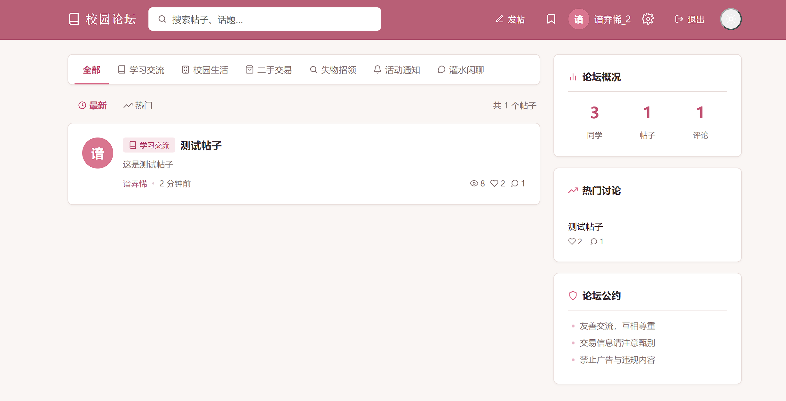

# Campus Forum

**English** | [简体中文](README.zh-CN.md)

A small campus forum built with Flask and SQLite. All backend code lives in `app.py`. The frontend is a set of Jinja2 templates plus hand-written CSS and JavaScript, with no bundler, no npm and no CDN.



## Introduction

The forum is meant for a class or a club, so the setup stays small: one Python process and one `forum.db` file. Copying that file is enough to back up or move the whole site.

Accounts work with username and password. The first account registered on a fresh database becomes the administrator. After that, users can post in six sections, comment and reply, like, favorite, search, and edit their own posts.

Each user gets a profile page with separate post and comment tabs, a favorites page, and a settings page for nickname, avatar color and bio. Administrators can pin posts and delete any post or comment.

The interface has a light/dark toggle remembered in `localStorage`, and the layout collapses to a single column on narrow screens.

## Dependencies

Runtime:

```text
flask>=3.0
```

Development:

```text
-r requirements.txt
pytest>=8.0
```

Python 3.9 or newer. `sqlite3` is part of the standard library, so there is nothing else to install. The frontend uses no third-party packages at all.

## Project Structure

```text
.
├── app.py                  # config, database, auth, routes, filters
├── forum.db                # created on first run
├── .secret_key             # generated on first run, gitignored
├── requirements.txt
├── requirements-dev.txt
├── templates/
│   ├── base.html           # layout, navbar, flash messages
│   ├── _ui.html            # icon, avatar, badge and pager macros
│   ├── _post_form.html     # form shared by new and edit
│   ├── index.html
│   ├── post_detail.html
│   ├── new_post.html
│   ├── edit_post.html
│   ├── favorites.html
│   ├── user_home.html
│   ├── settings.html
│   ├── login.html
│   ├── register.html
│   └── error.html
├── static/
│   ├── css/style.css
│   ├── js/main.js
│   └── favicon.svg
└── tests/
    └── test_app.py
```

## Usage

Install and start:

```bash
pip install -r requirements.txt
python app.py
```

Then open <http://127.0.0.1:5000>. Tables are created on startup, so there is no separate initialization step.

To clear all data, stop the server, delete `forum.db`, and start again.

A few things can be changed through environment variables:

- `CAMPUS_DATABASE` sets the database file path.
- `CAMPUS_SECRET_KEY` sets the session secret. Without it, a key is generated into `.secret_key` on first run.
- `CAMPUS_COOKIE_SECURE=1` marks the session cookie as `Secure`, which you want when the site runs over HTTPS.

To use another port, change the last line of `app.py`:

```python
app.run(host="127.0.0.1", port=5000, debug=False);
```

### Pages and routes

| Method | Path | Notes |
| --- | --- | --- |
| GET | `/` | Post list, accepts `section`, `q`, `sort`, `page` |
| GET, POST | `/register` | |
| GET, POST | `/login` | Accepts an in-site `next` parameter |
| POST | `/logout` | |
| GET, POST | `/post/new` | Login required |
| GET | `/post/<id>` | Increments the view count |
| GET, POST | `/post/<id>/edit` | Author or admin |
| POST | `/post/<id>/comment` | Login required |
| POST | `/post/<id>/like` | Returns JSON |
| POST | `/post/<id>/favorite` | Returns JSON |
| POST | `/post/<id>/delete` | Author or admin |
| POST | `/post/<id>/pin` | Admin only |
| POST | `/comment/<id>/delete` | Author or admin |
| GET | `/user/<id>` | `tab=posts` or `tab=comments` |
| GET | `/favorites` | Login required |
| GET, POST | `/settings` | Login required |

Visiting a protected page while logged out shows a message and redirects to `/login?next=...`. Insufficient permissions return 403.

### Database

There are five tables: `users`, `posts`, `comments`, `likes` and `favorites`. Every request connection enables foreign keys, WAL, `synchronous=NORMAL` and a five second busy timeout. Likes and favorites use a composite primary key, so a user can only like or favorite a post once. Replies are stored through `comments.parent_id`, which allows one level of nesting.

`init_db()` uses `CREATE TABLE IF NOT EXISTS`, so an existing database keeps working. The only migration it does is adding `posts.edited_at` to older databases that lack the column.

### Security

CSRF tokens live in the session and are exposed through `<meta name="csrf-token">`. Forms submit them as a hidden field, JSON requests send `X-CSRF-Token`. A missing or wrong token returns 400.

Login failures are counted per IP and username in memory. Five failures lock that pair for five minutes. The counter is cleared on restart and is not shared between worker processes.

Every response includes `X-Content-Type-Options`, `X-Frame-Options`, `Referrer-Policy`, `Permissions-Policy` and a same-origin CSP. Passwords are stored as Werkzeug hashes. All SQL is parameterized, and `%`, `_` and `\` are escaped before a `LIKE` search. The login `next` parameter only accepts in-site paths starting with a single `/`.

Post and comment bodies are rendered as plain text with `white-space: pre-wrap`, never as HTML.

### Tests

```bash
pip install -r requirements-dev.txt
python -m pytest tests -q
```

The suite covers registration and the admin rule, login and lockout, CSRF rejection, post creation and editing, permissions, comments and replies, likes, favorites, search escaping, bad page numbers, security headers, XSS escaping, admin actions and the profile tabs. All 19 cases pass.

## Contributing

Issues and pull requests are welcome. Before changing something, read through `app.py` first; it is ordered by request lifecycle: config, database, hooks, permission decorators, helpers, routes.

Please run the tests before sending a patch:

```bash
python -m pytest tests -q
```

The built-in Flask server is for local use only. For anything public, put it behind a WSGI server such as Gunicorn or uWSGI and set `CAMPUS_SECRET_KEY`.

## Contact

Ailan Anjuxi (谙弆悕博士)

- Email: [anjuxi.ME@outlook.com](mailto:anjuxi.ME@outlook.com)
- SIP: [sip:anjuxi@sip.linphone.org](sip:anjuxi@sip.linphone.org)

Written for learning and classroom demos. Released under the MIT license, see [LICENSE](LICENSE).
