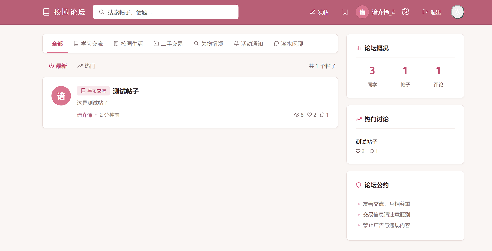

# 校园论坛

[English](README.md) | **简体中文**

用 Flask + SQLite 写的一个小论坛。后端代码都在 `app.py` 里，前端是 Jinja2 模板加手写的 CSS 和 JavaScript，没有打包工具，不用 npm，也不引用 CDN。



## 项目介绍

论坛是给班级、社团这类小范围用的，所以尽量保持简单：一个 Python 进程，一个 `forum.db` 文件。备份或者搬家的时候，把这个文件复制走就行。

账号用用户名加密码。数据库为空时，第一个注册的账号自动成为管理员。之后用户可以按板块发帖、评论和回复、点赞、收藏、搜索，也可以修改自己发过的帖子。

每个用户有独立的主页，「帖子」和「评论」分成两个标签页。另外还有收藏页，以及一个设置页，用来改昵称、头像配色、个性签名和密码。管理员可以置顶帖子，也能删除任意帖子和评论。

界面支持明暗主题切换，偏好记在 `localStorage` 里。窄屏下两栏布局会自动变成单栏。

## 依赖说明

运行只需要 Flask：

```text
flask>=3.0
```

跑测试再加 pytest：

```text
-r requirements.txt
pytest>=8.0
```

Python 3.9 及以上。`sqlite3` 是标准库自带的，不用单独安装。前端也没有任何第三方包。

## 项目结构

```text
.
├── app.py                  # 配置、数据库、登录、路由、过滤器
├── forum.db                # 首次启动自动创建
├── .secret_key             # 首次启动自动生成，已在 .gitignore 里
├── requirements.txt
├── requirements-dev.txt
├── templates/
│   ├── base.html           # 页面骨架、导航、提示消息
│   ├── _ui.html            # 图标、头像、徽章、分页的宏
│   ├── _post_form.html     # 发帖和编辑共用的表单
│   ├── index.html
│   ├── post_detail.html
│   ├── new_post.html
│   ├── edit_post.html
│   ├── favorites.html
│   ├── user_home.html
│   ├── settings.html
│   ├── login.html
│   ├── register.html
│   └── error.html
├── static/
│   ├── css/style.css
│   ├── js/main.js
│   └── favicon.svg
└── tests/
    └── test_app.py
```

## 使用说明

先装依赖，再启动：

```bash
pip install -r requirements.txt
python app.py
```

浏览器打开 <http://127.0.0.1:5000> 就能用。启动时会自动建表，不需要手动初始化数据库。

想清空数据，停掉服务，删掉根目录的 `forum.db`，再启动一次就重新建好了。

有几个环境变量可以调整：

- `CAMPUS_DATABASE` 指定数据库文件的位置。
- `CAMPUS_SECRET_KEY` 指定会话密钥。不设置的话，首次启动会生成一份存进 `.secret_key`。
- `CAMPUS_COOKIE_SECURE=1` 会给会话 Cookie 加上 `Secure`，站点跑在 HTTPS 上时应该打开。

端口在 `app.py` 最后一行改：

```python
app.run(host="127.0.0.1", port=5000, debug=False);
```

### 页面与接口

| 方法 | 路径 | 说明 |
| --- | --- | --- |
| GET | `/` | 帖子列表，支持 `section`、`q`、`sort`、`page` |
| GET, POST | `/register` | 注册 |
| GET, POST | `/login` | 登录，支持站内 `next` 跳回 |
| POST | `/logout` | 退出 |
| GET, POST | `/post/new` | 发帖，需登录 |
| GET | `/post/<id>` | 帖子详情，浏览量加一 |
| GET, POST | `/post/<id>/edit` | 编辑，作者或管理员 |
| POST | `/post/<id>/comment` | 发评论，需登录 |
| POST | `/post/<id>/like` | 点赞切换，返回 JSON |
| POST | `/post/<id>/favorite` | 收藏切换，返回 JSON |
| POST | `/post/<id>/delete` | 删帖，作者或管理员 |
| POST | `/post/<id>/pin` | 置顶切换，仅管理员 |
| POST | `/comment/<id>/delete` | 删评论，作者或管理员 |
| GET | `/user/<id>` | 用户主页，`tab=posts` 或 `tab=comments` |
| GET | `/favorites` | 我的收藏，需登录 |
| GET, POST | `/settings` | 资料与密码，需登录 |

没登录就访问需要登录的页面，会先提示再跳到 `/login?next=原路径`。权限不够返回 403。

### 数据库

一共五张表：`users`、`posts`、`comments`、`likes`、`favorites`。每个请求的连接都开了外键、WAL、`synchronous=NORMAL` 和 5 秒的 busy timeout。点赞和收藏用联合主键，同一个人对同一个帖子只能记一次。回复靠 `comments.parent_id` 指向上一条评论，所以只支持一级。

`init_db()` 用 `CREATE TABLE IF NOT EXISTS` 建表，已有的 `forum.db` 不会受影响。目前只有一处迁移：老库缺少 `posts.edited_at` 时把这一列补上。

### 安全相关

CSRF 令牌存在 session 里，通过 `<meta name="csrf-token">` 交给页面。表单用隐藏字段提交，fetch 请求放在 `X-CSRF-Token` 请求头里。缺失或者对不上都返回 400。

登录失败按 IP 加用户名计数，连续错 5 次锁 5 分钟。计数存在进程内存里，重启清空，多进程之间也不共享。

响应会带上 `X-Content-Type-Options`、`X-Frame-Options`、`Referrer-Policy`、`Permissions-Policy` 和同源 CSP。密码只存 Werkzeug 的哈希。SQL 全部走参数化占位符，`LIKE` 搜索前先转义 `%`、`_` 和 `\`。登录的 `next` 只接受以单个 `/` 开头的站内路径。

帖子和评论正文按纯文本输出，用 `white-space: pre-wrap` 保留换行，不当作 HTML 渲染。

### 测试

```bash
pip install -r requirements-dev.txt
python -m pytest tests -q
```

用例覆盖注册与管理员规则、登录与锁定、CSRF 拦截、发帖与编辑、权限、评论与回复、点赞、收藏、搜索转义、非法页码、安全响应头、XSS 转义、管理员操作和个人主页标签页，目前 19 个全部通过。

## 贡献指南

提 issue 或者 pull request 都可以。改代码前建议先看一遍 `app.py`，它是按请求的生命周期排的：配置、数据库、请求钩子、权限装饰器、工具函数、路由。

提交之前请跑一下测试：

```bash
python -m pytest tests -q
```

Flask 自带的服务器只适合本地和演示。要对外提供服务，请放到 Gunicorn、uWSGI 这类 WSGI 服务器后面，并设置 `CAMPUS_SECRET_KEY`。

## 联系作者

谙弆悕博士（Ailan Anjuxi）

- 邮箱：[anjuxi.ME@outlook.com](mailto:anjuxi.ME@outlook.com)
- SIP：[sip:anjuxi@sip.linphone.org](sip:anjuxi@sip.linphone.org)

本项目用于学习和课堂演示，许可证是 MIT，详见 [LICENSE](LICENSE)。
